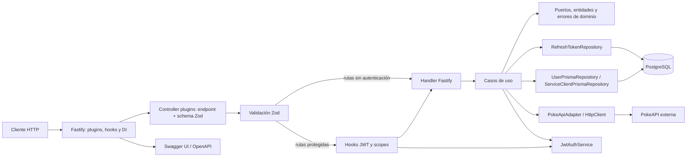

# Backend Chasis Fastify Back

## Alcance

Este documento describe el comportamiento evidenciado por la implementación actual en TypeScript. El repositorio es un chasis reutilizable para backends Fastify con usuarios, autenticación, health y un ejemplo de integración con PokeAPI.

## Ejecución y puntos de entrada

- `src/main.ts` conecta Prisma con PostgreSQL antes de escuchar en `PORT` (por defecto `3000`). Por eso, aunque el controlador de health no consulta la base de datos, la aplicación no empieza a aceptar solicitudes si falla la conexión inicial. Desconecta Prisma durante `SIGINT` y `SIGTERM` y finaliza con código `1` si falla esa conexión.
- `src/server.ts` crea la aplicación Fastify, registra el scope Awilix por solicitud, Zod para validación/serialización, Swagger UI en `/docs` y los plugins `/chasis/health` y `/chasis/v1`.
- Las rutas desconocidas devuelven `{ "message": "Route not found", "code": 404 }`.

OpenAPI usa el origen desde el que se sirve; las rutas publicadas incluyen el prefijo `/chasis`. La interfaz se sirve en `/docs` y el JSON en `/docs/json`.

## Arquitectura observada

El flujo de dependencias implementado es controller plugins HTTP → casos de uso de aplicación → interfaces/entidades/errores de dominio → repositorios/adaptadores de infraestructura. Awilix usa inyección clásica; `requestScopePlugin` adjunta un contenedor scoped a cada solicitud y los handlers resuelven desde allí los casos de uso registrados en `src/config/container.ts`.

Las etiquetas arquitectónicas de las guías del repositorio describen DDD/arquitectura hexagonal/Clean Architecture; el diagrama registra las relaciones confirmadas por imports y llamadas.

El HTML interactivo `docs/arquitectura.html` y sus recibos son un artefacto arquitectónico previo a esta migración, no la fuente vigente para la estructura HTTP. Para el estado Fastify, usa este documento y el código en `src/`.

Como ejemplo de uso del chasis, consulta la [arquitectura de referencia para recompensas y lealtad](architecture-reference/architecture.md). Es una propuesta separada del backend implementado y contiene vistas de componentes y alternativas de infraestructura AWS, Azure y Google Cloud.

## Índice de casos de uso de la API

### Health

- [Verificar salud](use-case/health-check.md) — `GET /chasis/health`

### Integración de ejemplo

- [Consultar Pokémon por nombre](use-case/get-pokemon-by-name.md) — `GET /chasis/v1/generic/pokemon/:name`
- [Consultar especie de Pokémon](use-case/get-pokemon-species.md) — `GET /chasis/v1/generic/pokemon-species/:name`

### Usuarios

- [Registrar usuario](use-case/register-user.md) — `POST /chasis/v1/users/register`
- [Iniciar sesión](use-case/login-user.md) — `POST /chasis/v1/auth/login`
- [Renovar tokens](use-case/refresh-tokens.md) — `POST /chasis/v1/auth/refresh`
- [Cerrar sesión](use-case/logout.md) — `POST /chasis/v1/auth/logout`
- [Consultar usuario actual](use-case/get-current-user.md) — `GET /chasis/v1/users/me`
- [Listar usuarios](use-case/list-users.md) — `GET /chasis/v1/users`

### Clientes de servicio

- [Autenticación con credenciales de cliente](use-case/client-credentials.md) — `POST /chasis/v1/auth/client-credentials`
- [Crear cliente de servicio](use-case/create-service-client.md) — `POST /chasis/v1/auth/service-clients`
- [Rotar secreto de cliente](use-case/rotate-service-client-secret.md) — `POST /chasis/v1/auth/service-clients/:clientId/rotate-secret`
- [Deshabilitar cliente de servicio](use-case/disable-service-client.md) — `PATCH /chasis/v1/auth/service-clients/:clientId/disable`

## Autenticación y autorización

Los JWT se firman con HS256 usando `JWT_SECRET`, con valores predeterminados de `15m` para tokens de acceso y `30d` para tokens de renovación. El listado paginado requiere `users:read`, el perfil actual requiere `user` y la administración de clientes requiere `service-clients:manage`. Los refresh tokens son de un solo uso; su hash se reemplaza en una transacción. Logout elimina el hash del refresh presentado; los access tokens emitidos continúan válidos hasta expirar aunque se cierre sesión o se deshabilite la identidad.

La aplicación exige `JWT_SECRET` y `DATABASE_URL` al iniciar.

## Validación y errores

Las rutas registran schemas Zod directamente en Fastify. Esto alimenta la validación, la inferencia de tipos, la serialización de respuestas y OpenAPI. Los datos inválidos en body, params o query devuelven HTTP `422` con `code: VALIDATION_ERROR`. Los JWT faltantes o inválidos devuelven HTTP `401`; los scopes ausentes o insuficientes devuelven `403/FORBIDDEN`.

`DomainException` es convertido por el error handler global a su estado HTTP y `{ code, message }`. Un JSON mal formado devuelve `400/INVALID_JSON`; los errores desconocidos devuelven `500/INTERNAL_SERVER_ERROR` sin detalles internos.

## Persistencia

Prisma 7 con `@prisma/adapter-pg` se conecta a PostgreSQL mediante `DATABASE_URL`. Los repositorios activos de usuarios y clientes de servicio usan modelos Prisma en el schema `test`. Los usuarios almacenan un hash bcrypt de la contraseña; los clientes de servicio almacenan un hash bcrypt del secreto, scopes y estado. Los refresh tokens se guardan como hashes en `test.refresh_tokens`.

El schema también define `addresses`, pero ninguna ruta o caso de uso actual lo utiliza. Las migraciones están en `prisma/migrations/`.

## Integración externa y logging

Winston emite logs JSON en consola. Un hook Fastify registra método, ruta, código de respuesta y duración sin incluir query strings ni cuerpos; el cliente HTTP registra metadatos de solicitudes/respuestas y errores.

## Despliegue y verificación

El Dockerfile construye con Node 24, genera el cliente Prisma, compila TypeScript y ejecuta `dist/main.js` en el puerto `3000`. Docker Compose define los contenedores de la aplicación, PostgreSQL, Floci y SQS admin; no aplica migraciones automáticamente, que se ejecutan con `npm run prisma:deploy` cuando corresponda. El código actual no contiene clientes del AWS SDK ni consumidores de eventos/colas; por eso esos servicios de Compose son soporte de infraestructura y no integraciones de aplicación evidenciadas.

Las pruebas usan Vitest y `app.inject()` para HTTP; cubren rutas Fastify, validación, autenticación, scopes, errores, casos de uso, repositorios, JWT y cliente HTTP. Los scripts incluyen `npm run build`, `npm run test:run` y comandos Prisma.

## Vacíos e inconsistencias de evidencia

- El controller de health devuelve una respuesta literal y no comprueba la disponibilidad actual de la base de datos.
- `GET /chasis/v1/users` devuelve un objeto paginado y OpenAPI documenta ese objeto.
- `GET /chasis/v1/users/me` puede devolver `phone: null`; Zod refleja esa nulabilidad.
- Las respuestas de error de los endpoints se describen en OpenAPI con schemas compartidos.
