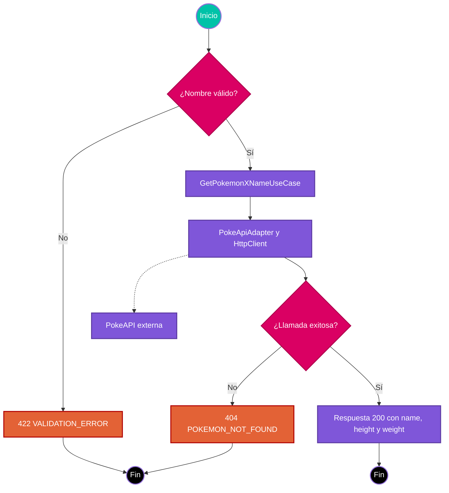

# Caso de uso: Consultar Pokémon por nombre

> **Endpoint:** GET `/chasis/v1/generic/pokemon/:name`  
> **Versión:** v1

## Descripción

Ruta pública de ejemplo que consulta PokeAPI. El parámetro de ruta `name` es
una cadena de al menos un carácter; no requiere bearer token ni body.

## Flujo principal

1. Fastify valida el parámetro con Zod.
2. `GetPokemonXNameUseCase` solicita la información al puerto `IPokeApiAdapter`.
3. `PokeApiAdapter` llama mediante `HttpClient` a PokeAPI con un tiempo de espera de cuatro segundos y devuelve nombre, altura y peso.
4. El controller responde con los datos. El adaptador convierte cualquier error de la llamada en `POKEMON_NOT_FOUND`.

## Respuestas

Una consulta exitosa devuelve `200` con `{ "name": "pikachu", "height": 4, "weight": 60 }`. El parámetro inválido devuelve `422 VALIDATION_ERROR`. Cualquier error de la integración, incluido un fallo de conectividad, se traduce actualmente a `404 POKEMON_NOT_FOUND`.

## Diagrama de flujo

## Detalles de implementación

El contrato OpenAPI se genera desde el schema registrado en el controller
`src/infraestructure/controllers/v1/generic.controller.ts`.
