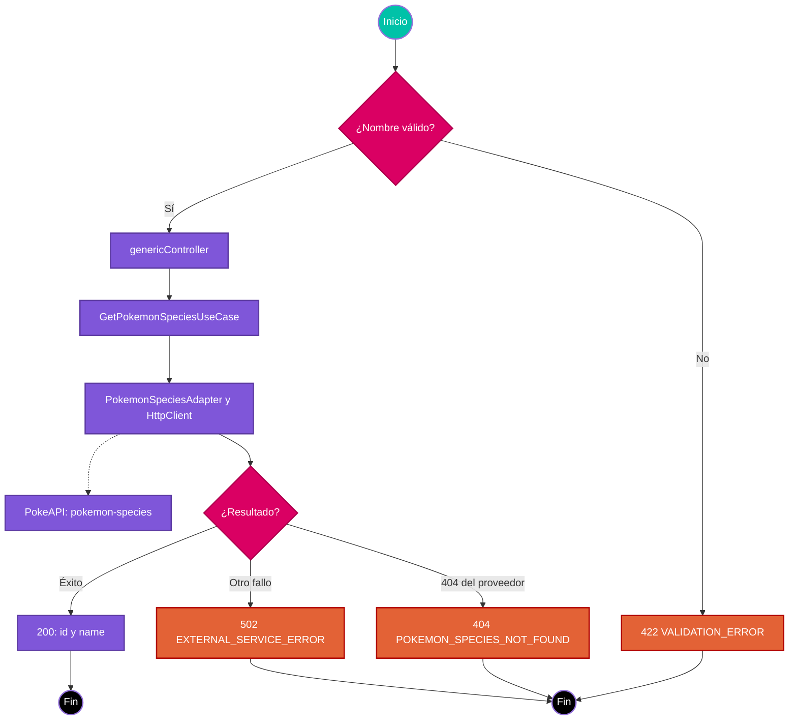

# Caso de uso: Consultar especie de Pokémon

> **Endpoint:** `GET /chasis/v1/generic/pokemon-species/:name`  
> **Versión:** v1

## Descripción

Ruta pública de ejemplo que consulta una especie por nombre o identificador en PokeAPI y devuelve su identificador y nombre. El endpoint existente de Pokémon permanece independiente.

## Detalles del endpoint

- **Método:** `GET`.
- **Ruta:** `/chasis/v1/generic/pokemon-species/:name`.
- **Versión:** `v1`.
- **Respuesta:** JSON.

## Actores

- **Cliente HTTP:** solicita los datos de una especie.
- **PokeAPI:** provee los datos consultados por el adaptador.

## Precondiciones y requisitos

La aplicación debe estar disponible. Para una respuesta exitosa, PokeAPI debe responder con los campos `id` y `name` esperados. La ruta no registra hooks de autenticación ni autorización. No necesita datos de entrada en el cuerpo ni parámetros de consulta.

## Parámetros de entrada

### Parámetros de ruta

| Nombre | Tipo | Obligatorio | Validación |
| --- | --- | --- | --- |
| `name` | string | Sí | El schema Zod exige al menos un carácter. Se pasa a PokeAPI como parámetro de ruta codificado. |

### Headers y cuerpo

No se declara un header específico ni se utiliza un cuerpo de solicitud. No se requiere bearer token.

## Flujo principal

1. Fastify recibe la solicitud y valida `name` mediante `pokemonParamsSchema`.
2. `genericController` resuelve `GetPokemonSpeciesUseCase` desde el contenedor de la petición.
3. El caso de uso llama al puerto `IPokemonSpeciesAdapter` con el nombre recibido.
4. `PokemonSpeciesAdapter` consulta `GET https://pokeapi.co/api/v2/pokemon-species/:name` mediante `HttpClient`, con un timeout de 4000 ms.
5. El adaptador selecciona `id` y `name`; el controller responde HTTP 200 con esos campos.

## Respuestas

### Éxito (200)

```json
{
  "id": 25,
  "name": "pikachu"
}
```

### Errores

| HTTP | Código | Mensaje | Causa |
| --- | --- | --- | --- |
| 422 | `VALIDATION_ERROR` | `Invalid request` | El parámetro no cumple el schema Zod. La respuesta puede incluir `errors`. |
| 404 | `POKEMON_SPECIES_NOT_FOUND` | `Pokemon species not found` | PokeAPI responde con estado 404. |
| 502 | `EXTERNAL_SERVICE_ERROR` | `Extenal API error` | La llamada al proveedor falla por otra causa, como error de red o timeout. El mensaje reproduce el texto actualmente definido en el proyecto. |
| 500 | `INTERNAL_SERVER_ERROR` | `Internal Server Error` | El manejador global recibe un error inesperado fuera de los casos anteriores. |

## Reglas y excepciones

- El identificador o nombre se transmite al proveedor; no se aplica normalización adicional en el caso de uso.
- El cliente HTTP codifica los parámetros de ruta. El adaptador no expone el detalle del error externo.
- Los errores previstos se representan mediante `DomainException` y el manejador global genera la respuesta.

## Diagrama de flujo



## Detalles de implementación

- Controller y ruta: `src/infraestructure/controllers/v1/generic.controller.ts`.
- Contratos Zod y OpenAPI: `src/infraestructure/schemas/pokemon.schema.ts`.
- Caso de uso: `src/application/use-cases/generic/get-pokemon-species.usecase.ts`.
- Puerto: `src/domain/interfaces/adapters/pokemon-species.adapter.interface.ts`.
- Adaptador: `src/infraestructure/adapters/pokemon-species.adapter.ts`.
- Composición: `src/config/container.ts`; errores HTTP: `src/infraestructure/hooks/error.hook.ts`.

## Notas técnicas

La consulta no accede a la base de datos ni publica eventos. El contrato OpenAPI se genera desde los schemas registrados en la ruta. Las pruebas del adaptador simulan el cliente HTTP; las pruebas HTTP usan `app.inject()` y un caso de uso simulado, por lo que no acreditan conectividad real con PokeAPI.

## Ejemplo

```bash
curl http://localhost:3000/chasis/v1/generic/pokemon-species/pikachu
```
