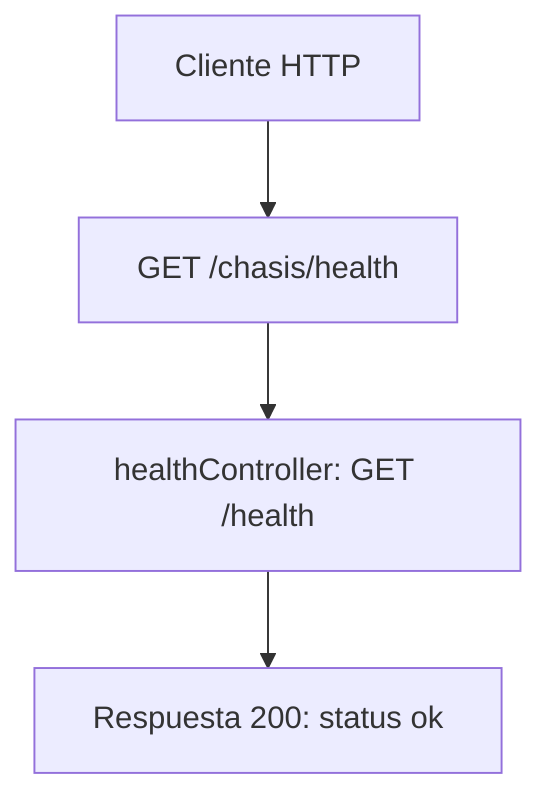

# Caso de uso: Verificación de salud

> **Endpoint:** GET `/chasis/health`  
> **Versión:** sin versión

## Descripción

Permite comprobar que la API responde.

## Detalles del endpoint

| Método | Ruta | Content-Type |
| --- | --- | --- |
| GET | `/chasis/health` | No aplica |

## Actores

- **Cliente HTTP:** solicita el estado de la API.

## Precondiciones y prerrequisitos

- No se requiere autenticación y el controlador no consulta la base de datos. Sin embargo, `src/main.ts` solo inicia el listener después de conectar Prisma, así que la API no sirve esta ruta cuando falla la conexión inicial.

## Parámetros de entrada

No recibe headers, parámetros de ruta, query ni body documentados.

## Flujo principal

1. Fastify despacha `GET /health` al handler registrado por `healthController` bajo el prefijo `/chasis`.
2. El handler devuelve una respuesta JSON literal.
3. Aunque `HealthService` está registrado en el contenedor, este handler no lo resuelve ni lo invoca.

## Respuestas

### Éxito (`200`)

```json
{ "status": "ok", "service": "chasis-fastify-back" }
```

### Errores

No hay errores específicos definidos por este caso de uso. Los errores inesperados se manejan globalmente como `500/INTERNAL_SERVER_ERROR`.

## Reglas específicas

- La respuesta no representa una comprobación activa de PostgreSQL; el controlador devuelve valores constantes.

## Detalles de implementación

- Controller/plugin HTTP: `src/infraestructure/controllers/health.controller.ts`.

## Diagrama de flujo


