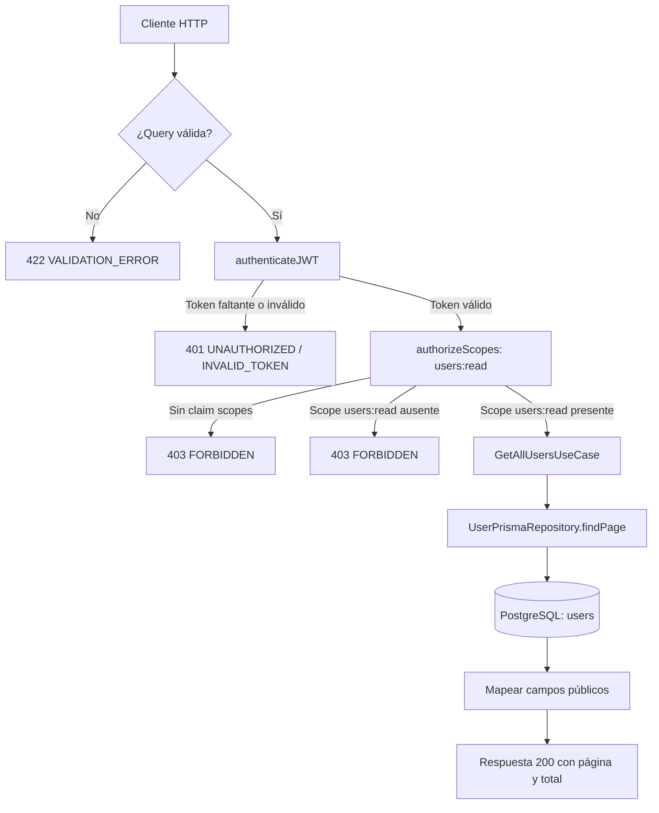

# Caso de uso: Listar usuarios

> **Endpoint:** GET `/chasis/v1/users/`  
> **Versión:** v1

## Descripción

Consulta usuarios paginados y devuelve únicamente los campos definidos por el caso de uso.

## Detalles del endpoint

| Método | Ruta | Content-Type |
| --- | --- | --- |
| GET | `/chasis/v1/users/` | No aplica |

## Actores

- **Cliente autorizado:** consume el listado con scope `users:read`.
- **PostgreSQL/Prisma:** obtiene los usuarios.

## Precondiciones y prerrequisitos

- Se requiere JWT de acceso válido.
- El JWT debe incluir el scope `users:read`.

## Parámetros de entrada

### Headers

| Nombre | Tipo | Requerido | Descripción |
| --- | --- | --- | --- |
| `Authorization` | string | Sí | `Bearer <token>` con JWT de acceso y scope `users:read`. |

No recibe body ni parámetros de ruta. Acepta los parámetros de consulta `page` y `pageSize`, enteros positivos; sus valores predeterminados son `1` y `20`, y `pageSize` admite hasta 100 registros.

## Flujo principal

1. Se validan los parámetros de consulta; luego se autentica la solicitud y se verifica el scope.
2. `GetAllUsersUseCase` consulta la página ordenada por número de documento y el total mediante `UserPrismaRepository.findPage`.
3. Cada usuario se transforma a documento, nombre, email, teléfono, `hasPin` y `status`.
4. El controlador devuelve `items`, `page`, `pageSize` y `total`. Una página fuera del rango devuelve `items` vacío.

La página y el conteo se consultan por separado y en paralelo; el repositorio no los agrupa en una transacción, por lo que cambios concurrentes pueden hacer que `items` y `total` reflejen momentos distintos.

## Respuestas

### Éxito (`200`)

```json
{ "page": 1, "pageSize": 20, "total": 1, "items": [
  {
    "documentType": "CC",
    "documentNumber": "1037630472",
    "fullName": "Julian Arango",
    "email": "julian@email.com",
    "phone": "3117468187",
    "hasPin": false,
    "status": true
  }
] }
```

### Errores

Una query inválida devuelve `422/VALIDATION_ERROR`. La autenticación y autorización usan los errores compartidos. Un error inesperado del repositorio devuelve `500/INTERNAL_SERVER_ERROR`.

## Diagrama de flujo


