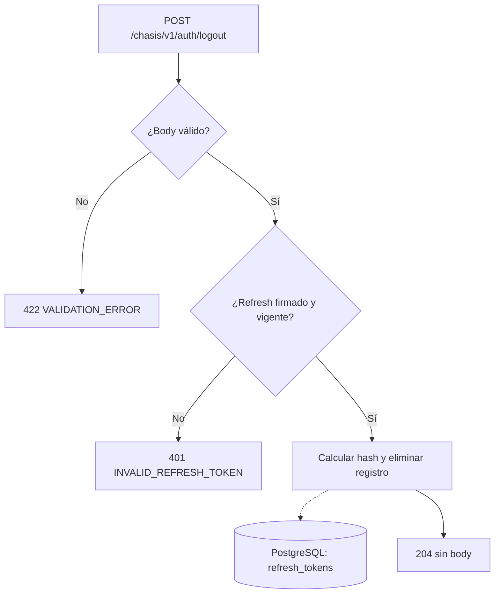

# Caso de uso: Cerrar sesión

> **Endpoint:** POST `/chasis/v1/auth/logout`  
> **Versión:** v1

## Descripción y entrada

Invalida el refresh token presentado. La ruta recibe un body JSON con
`refreshToken`, cadena no vacía; el refresh es la credencial y no se requiere
un access token. El token debe tener firma válida, no haber expirado y ser de
tipo `refresh`.

## Flujo principal y respuestas

1. Fastify valida el body y `LogoutUseCase` verifica el refresh mediante `IAuthService`.
2. `RefreshTokenRepository` calcula su hash SHA-256 y elimina el registro correspondiente en `test.refresh_tokens`.
3. Se responde `204` sin body. Repetir con un refresh válido y vigente ya eliminado también responde `204`.

Un body inválido devuelve `422 VALIDATION_ERROR`; un refresh inválido, expirado
o de tipo access devuelve `401 INVALID_REFRESH_TOKEN`. Un error inesperado de
persistencia se trata como `500 INTERNAL_SERVER_ERROR`.

## Límites

Los access tokens existentes siguen siendo válidos hasta su vencimiento y las
otras sesiones no se modifican. Logout y renovación compiten por el mismo hash:
si la renovación gana primero, logout sobre el token anterior devuelve `204`
pero no revoca el refresh sucesor; el cliente debe cerrar con el sucesor. No
se realiza revocación por familia de tokens.

## Diagrama de flujo

